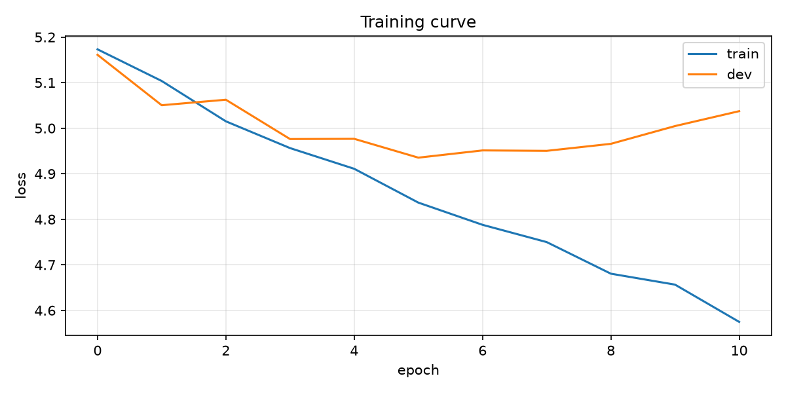
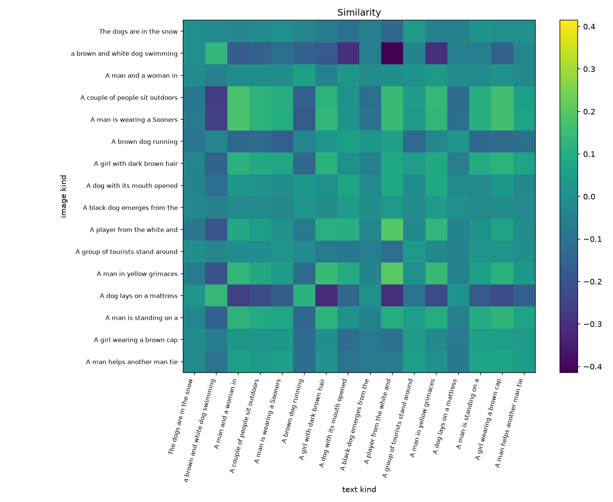
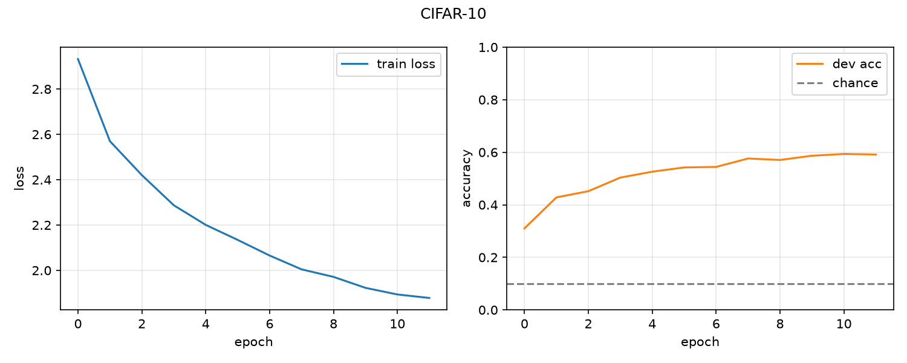
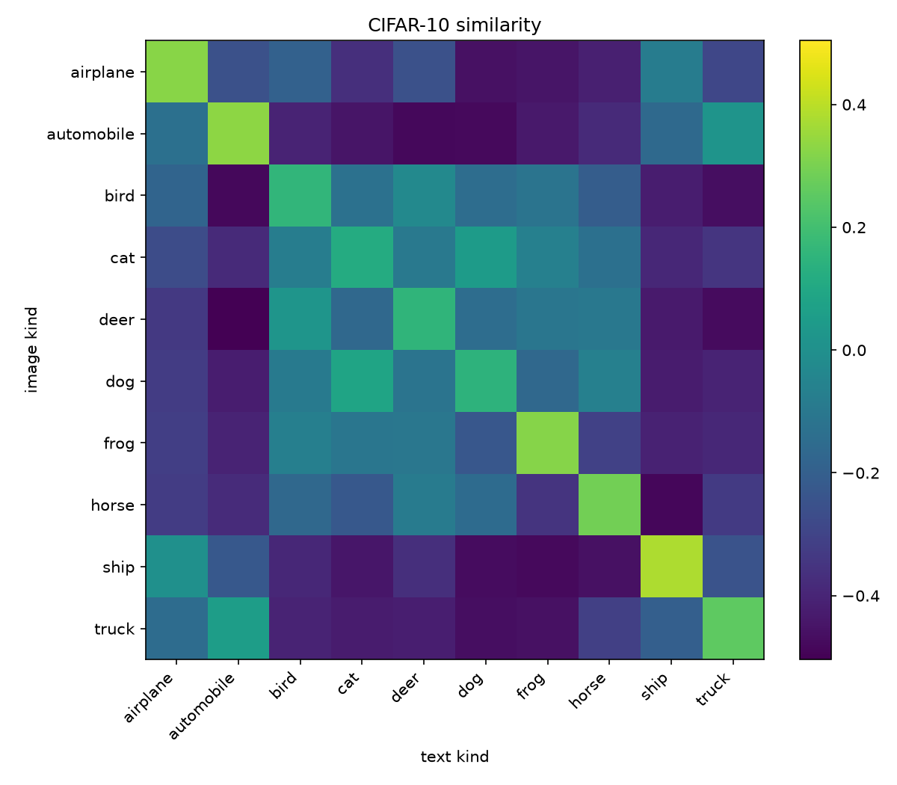
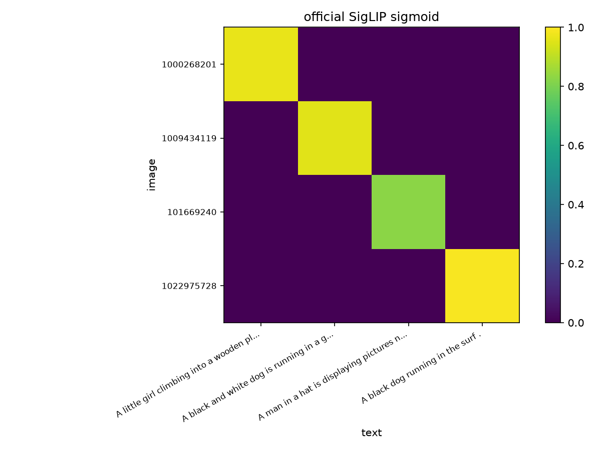
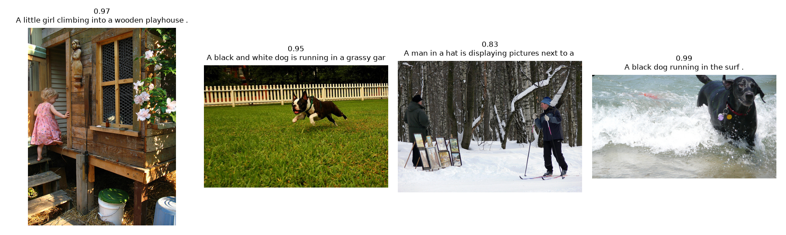

# Sigmoid Loss for Language-Image Pre-training (SigLIP)

### 选择语言 | Language

[中文简介](#简介) | [English](#introduction)

### 结果 | Result

本复现对应 notebook `SigLIP论文复现.ipynb` 里的三个实验。前两个从零训练缩小版双塔，第三个加载 Google 官方 `google/siglip-base-patch16-224` 做推理。

**实战 1：Flickr8k-2k 图文检索。** 训练损失持续下降，验证损失在中途见底后回升，早停留在验证损失最低的权重。测试集前 16 对的余弦相似度没有形成稳定对角线，这一节验证的是训练流程，检索对齐仍然很弱。

训练曲线（`curve.png`）：



测试集前 16 对图文余弦（`sim.png`）：



**实战 2：CIFAR-10 类别模板分类。** 训练损失从约 2.9 降到约 1.9。验证准确率从约 32% 升到约 60% 后走平，明显高于 10% 的随机水平。10×10 的「类图像均值 × 类名文本」矩阵对角更亮，飞机、汽车、青蛙、马、船、卡车更清楚，猫、鹿、狗更弱。

训练曲线（`curve_cifar10.png`）：



类别相似度（`sim_cifar10.png`）：



**实战 3：官方 B/16 推理。** 4 张 Flickr8k 图各自对上自己的 caption，匹配 4/4。sigmoid 概率分别约为 0.968、0.954、0.827、0.988。同一行的概率互不归一，不必加和为 1。

图文 sigmoid 概率（`sim_official.png`）：



每张图取得分最高的 caption（`infer_official.png`）：



---

## 简介

Sigmoid Loss for Language-Image Pre-Training（简称 SigLIP）由 **Xiaohua Zhai、Basil Mustafa、Alexander Kolesnikov、Lucas Beyer** 于 2023 年提出（ICCV 2023）。它保留 CLIP 的双塔图文预训练，把批内 softmax 对比损失换成**逐对 sigmoid 二分类损失**。每一对图文单独判断「配不配」，不再为了归一化去看整个 batch 的相似度矩阵。因此损失可以按设备分块计算，batch 可以加大，同时在较小 batch 上通常也比 softmax 更稳。

CLIP 的对称 InfoNCE 把一张图在 batch 内所有文本上做一次 softmax，再把一段文本在所有图上做一次 softmax。正样本的梯度依赖全部分母，分布式训练需要收集全局嵌入并物化 \(B \times B\) 矩阵。SigLIP 的每一项只依赖自己的 logit：匹配对标签 \(+1\)，其余对标签 \(-1\)，损失是 \(-\log\sigma(z_{ij}(t\mathbf{x}_i\cdot\mathbf{y}_j+b))\)，对全部配对求和后再除以 batch size。温度 \(t=\exp(t')\) 与偏置 \(b\) 都可学习。论文把 \(t'\) 初始化为 \(\log 10\)、\(b\) 初始化为 \(-10\)，让开训时大量负对的损失接近 0，避免负样本失衡把前几步梯度拉爆。分块实现下，显存里同时存在的相似度块从 \(B^2\) 降到单设备的 \(b^2\)，论文把 batch 推到一百万，并发现收益在大约 32k 之后很快变平。

论文 Table 1 里，从随机初始化训练的 SigLIP ViT-B/16（文本塔同为 Base，batch 32k，32 块 TPUv4，5 天）在 ImageNet 上达到 **73.4%** 零样本 Top-1。锁定图像塔、只训练文本塔的 SigLiT，用 g/14 图像塔在 4 块 TPUv4 上训练两天，达到 **84.5%**。这些数字来自 WebLI 规模的图文预训练，不能拿来和下面的小模型直接比。

本复现用 PyTorch 从零写出 notebook 里的双塔：视觉塔用 **MAP 头**聚合成图像向量，文本塔取**左填充后的最后一个 token**，激活为 **GELU tanh 近似**，相似度是 L2 归一化后的余弦，再乘 \(\exp(\texttt{logit\_scale})\) 并加上 \(\texttt{logit\_bias}\)。损失与论文算法 1 一致：标签矩阵 \(z=2I-1\)，再算 \(-\sum\log\sigma(z\cdot\mathrm{logit})/B\)。三个实验分别是 Flickr8k-2k 上的图文检索、CIFAR-10 上用类别模板做的分类，以及官方 B/16 权重的推理。前两个实验的宽度和层数都缩小了，只用来把这套算法跑通。

## 架构

整体仍是图像塔、文本塔、对比头。本复现按 notebook 实现，并与官方 `google/siglip-base-patch16-224` 的结构对应。论文的消融主要比较 sigmoid 与 softmax、bias 初值和 batch size；MAP 头和 GELU tanh 是这套模型的结构选择，不要写成那篇论文里「MAP 优于 CLS」的实验结论。

```
pixel_values (B,3,H,W) ──► Vision Tower ──► image_embeds (B,D) ─┐
                                                                 ├─► L2 归一化 + 余弦
input_ids (B,T)        ──► Text   Tower ──► text_embeds  (B,D) ─┘
                                                                 │
                                    exp(logit_scale) * 余弦 + logit_bias → logits
```

- **图像编码器**：输入切成不重叠的 patch，用带 bias 的卷积投影成序列，加上可学习位置编码，送入 Pre-LN Transformer。序列里没有 CLS token。编码器之后做一次 LayerNorm，再由 **MAP 头**池化：一个可学习的 probe 作为唯一 query，对全部 patch 做交叉注意力，接 LayerNorm、MLP 和残差，得到 `(B, D)`。官方 B/16 为 224 输入、patch 16、196 个 patch、768 维、12 层、12 头。
- **文本编码器**：词嵌入加可学习位置编码，送入**双向** Transformer（没有 CLIP 那种因果掩码），PAD 位置不参与注意力。最后做 LayerNorm，再用带 bias 的线性层作用到每个 token，取序列最后一个位置。本复现对文本**左填充**，这一位是 EOS。官方 B/16 的词表大小为 32000，最大长度 64，隐藏维 768，12 层、12 头。
- **共享空间**：两个塔的宽度相同，输出各自 L2 归一化。点积就是余弦相似度，范围在 \([-1,1]\)。本复现没有再投到另一个更小的 `embed_dim`。
- **温度与偏置**：`logit_scale` 以对数形式存储，前向使用 \(\exp(\texttt{logit\_scale})\)，保证温度为正。`logit_bias` 是 sigmoid 损失需要的校准项：softmax 自己有归一化，sigmoid 没有，全局偏移要单独学。架构示例里的初值是 \(\log 10\) 和 \(-10\)。两个小实验按当前负样本数改写了 bias 初值，见下一节。
- **Sigmoid 损失**：对 logits 构造 \(z=2I-1\)（对角线 \(+1\)，其余 \(-1\)），损失为 \(-\sum\log\sigma(z\cdot\mathrm{logit})/B\)。不要把 \(\pm 1\) 直接送进 `binary_cross_entropy_with_logits`，那个函数的目标是 0/1。除数是 batch size \(B\)，不是配对数 \(B^2\)。
- **推理**：官方模型输出 `logits_per_image`，再过 sigmoid。每一对图文有自己的概率，一行不必加和为 1。分类实验里没有分类头，预测是 10 句类别模板中 logit 最大的那一句。

**缩小配置（实战 1、实战 2）**：视觉塔和文本塔都是 4 层、192 维、3 头。优化器为 AdamW，学习率带 5% warmup 和余弦衰减，梯度裁剪 1.0；二维权重 weight decay 0.01，bias 与 LayerNorm 不做 weight decay。这是教学规模，参数量远小于官方约 203M 的 B/16。

## 实验与数据

三个实验共用上面的双塔和 sigmoid 损失，数据和任务不同。

### 实战 1：Flickr8k-2k 图文检索

从 Flickr8k 抽出 2000 张图，每张保留原来的 5 句 caption。划分沿用官方 train/dev/test 名单的前面一部分：**1600 / 200 / 200**。

- **任务**：batch 内图文对比。对角线是正样本，其余交叉配对是负样本。训练时每张图随机抽 1 句 caption；评估时用该图全部 5 句。
- **输入**：图像 224×224，patch 16。训练集做尺度 \((0.8,1.0)\) 的随机裁剪；验证和测试先缩放到 224 再中心裁剪。像素按均值 0.5、标准差 0.5 归一化。
- **文本**：自建词表。按字母数字切词，保留最高频词，上限 10000，另有 `<pad>`、`<unk>`、`<eos>`。序列长度 64，左填充，使 EOS 落在最后一位。
- **训练**：batch 64，学习率 \(1\times 10^{-4}\)，最多 20 个 epoch。bias 初值改成 \(\log(1/63)\)，对应这个 batch 里每张图的 63 个负文本。验证损失连续 5 轮不降则停止，并加载验证损失最低的权重。
- **指标**：测试集图找文、文找图的 Recall@1/5/10。图找文时，top-k 里出现该图任意一句 caption 即算命中。同时记录验证集上配对余弦和错配余弦。本轮曲线里训练损失下降、验证损失回升，相似度热力图也没有稳定对角线。

数据集说明见 Flickr8k：[https://academictorrents.com/details/9dea07ba660a722ae1008c4c8afdd303b6f6e53b](https://academictorrents.com/details/9dea07ba660a722ae1008c4c8afdd303b6f6e53b)。本目录使用其中抽出的 `flickr8k-2k`。

### 实战 2：CIFAR-10 类别模板分类

CIFAR-10 没有 caption。10 个类各写成一句模板：`a photo of a {class}`，元音开头的类用 `an`。一张图和自己的类名是正样本，另外 9 个类名是负样本。损失仍是逐对 sigmoid，比较对象是这 10 句文本，而不是 batch 里的其他图像。

- **数据规模**：训练集 50000 张、测试集 10000 张，分辨率 32×32。按种子 42 从训练集划出 5000 张做验证，实际训练 45000 张。10 类为 airplane、automobile、bird、cat、deer、dog、frog、horse、ship、truck。
- **预处理**：训练使用 padding 4 的随机裁剪和随机水平翻转；验证和测试只做归一化。均值和标准差都是 0.5。
- **模型**：同一套 4 层、192 维小模型。图像 32×32，patch 4，共 64 个 patch。文本最大长度 16，词表只来自这 10 句模板。
- **训练**：batch 256，学习率 \(3\times 10^{-4}\)，最多 12 个 epoch。bias 初值改成 \(\log(1/9)\)。验证准确率连续 3 轮不升则停止。
- **指标**：冻结后不做分类头，10 句模板中 logit 最大者即为预测类别，报告 Top-1 准确率。随机水平是 10%。再输出每类准确率，以及测试集上「每类图像嵌入的均值 × 类别文本嵌入」的 10×10 余弦矩阵。

本轮验证准确率从约 32% 升到约 60%。因为训练文本就是这 10 句模板，这个数字衡量的是图与这些类名的对齐，不是换一套没见过的类别名之后的迁移。

| Top-1 准确率 | 效果说明 |
| --- | --- |
| 10%（随机水平） | 图像与 10 句类名没有分开 |
| 25 ~ 40% | 开始能分开差异大的类 |
| 40 ~ 55% | 多数类的对角相似度高于错类 |
| 55 ~ 70% | 小模型在全量 CIFAR-10、单模板设定下已经形成稳定对齐 |
| 70%+ | 这一配置下很强的结果，本轮曲线停在约 60% |

数据集官方地址：[https://www.cs.toronto.edu/~kriz/cifar.html](https://www.cs.toronto.edu/~kriz/cifar.html)

### 实战 3：官方权重推理

加载 `google/siglip-base-patch16-224`，对应论文中的 B/16。视觉塔 92.88M 参数，文本塔 110.27M，合计 203.16M。配置为图像 224、patch 16、隐藏维 768、12 层 12 头；文本词表 32000、最大长度 64、同样 768 维 12 层 12 头。加载后的 \(\exp(\texttt{logit\_scale})=117.3308\)，\(\texttt{logit\_bias}=-12.9324\)。

从 Flickr8k-2k 取 4 张图和对应 caption，用官方 processor 做 `padding="max_length"`，使末位是 EOS。4 对全部命中：

| 图像 | 匹配 caption | sigmoid |
| --- | --- | --- |
| 小女孩爬进木制 playhouse | A little girl climbing into a wooden playhouse. | 0.968 |
| 黑白狗在草地奔跑 | A black and white dog is running in a grassy garden surrounded by a white fence. | 0.954 |
| 戴帽男子在滑雪者旁展示图片 | A man in a hat is displaying pictures next to a skier in a blue hat. | 0.827 |
| 黑狗在浪里跑 | A black dog running in the surf. | 0.988 |

第一张图若换用只写 entry way、不写 playhouse 的那一句 caption，余弦会低很多。notebook 因此改用写出 playhouse 的第 3 句（`#2`）。

---

## Introduction

Sigmoid Loss for Language-Image Pre-Training (SigLIP), proposed by **Xiaohua Zhai, Basil Mustafa, Alexander Kolesnikov, and Lucas Beyer** (ICCV 2023), keeps the CLIP dual-tower setup and replaces the in-batch softmax contrastive loss with a **pairwise sigmoid binary loss**. Each image-text pair is scored on its own. The loss no longer needs a global view of the similarity matrix, so it can be computed in chunks, supports larger batches, and is typically more stable than softmax at modest batch sizes.

CLIP's symmetric InfoNCE applies a softmax over all texts for each image and a softmax over all images for each text. The positive term depends on the full denominator, and a distributed implementation has to gather every embedding and materialize a \(B \times B\) matrix. In SigLIP each term depends only on its own logit. Matched pairs are labeled \(+1\) and all other pairs \(-1\). The loss is \(-\log\sigma(z_{ij}(t\mathbf{x}_i\cdot\mathbf{y}_j+b))\), summed over pairs and divided by the batch size. Both the temperature \(t=\exp(t')\) and the bias \(b\) are learned. The paper initializes \(t'=\log 10\) and \(b=-10\), so the many negative pairs start near zero loss and do not dominate the first updates. The chunked implementation stores a per-device block of size \(b^2\) at a time. The paper studies batch sizes up to one million and finds that gains flatten beyond a batch size of about 32k.

In Table 1 of the paper, a from-scratch SigLIP ViT-B/16 with a Base text tower, batch size 32k, 32 TPUv4 chips, and 5 days of training reaches **73.4%** zero-shot ImageNet Top-1. A locked-image SigLiT model with a g/14 image tower reaches **84.5%** after two days on 4 TPUv4 chips. Those numbers come from WebLI-scale pre-training and are not comparable to the small models below.

This reproduction implements the notebook's dual tower in PyTorch. The vision tower pools patches with a **MAP head**. The text tower reads the **last token after left padding**. The nonlinearity is the **tanh approximation of GELU**. Similarity is the cosine of L2-normalized embeddings, scaled by \(\exp(\texttt{logit\_scale})\) and shifted by \(\texttt{logit\_bias}\). The loss matches Algorithm 1: \(z=2I-1\), then \(-\sum\log\sigma(z\cdot\mathrm{logit})/B\). The three experiments are image-text retrieval on Flickr8k-2k, classification on CIFAR-10 with class-name prompts, and inference with the official B/16 checkpoint. The first two use a narrowed tower so the algorithm can be trained locally.

## Architecture

The model is an image tower, a text tower, and a contrastive head, matching the notebook and the released `google/siglip-base-patch16-224`. The paper's ablations compare sigmoid against softmax, the bias initialization, and the batch size. The MAP head and GELU tanh are part of this architecture; they should not be reported as a paper result that "MAP beats CLS."

```
pixel_values (B,3,H,W) ──► Vision Tower ──► image_embeds (B,D) ─┐
                                                                 ├─► L2 normalize + cosine
input_ids (B,T)        ──► Text   Tower ──► text_embeds  (B,D) ─┘
                                                                 │
                                    exp(logit_scale) * cosine + logit_bias → logits
```

- **Image encoder**: The image is split into non-overlapping patches, projected by a bias-enabled convolution, and added to learned positional embeddings. A Pre-LN Transformer follows. There is no CLS token. After a final LayerNorm, a **MAP head** pools the sequence: one learned probe is the only query, it cross-attends to every patch, and a LayerNorm-MLP residual block returns `(B, D)`. The official B/16 uses 224 input, patch size 16, 196 patches, width 768, 12 layers, and 12 heads.
- **Text encoder**: Token embeddings plus learned positional embeddings go through a **bidirectional** Transformer. There is no causal mask. PAD positions are excluded from attention. A LayerNorm and a bias-enabled linear layer are applied to every token, and the last position is kept. This reproduction **left-pads**, so that position is the EOS token. The official B/16 text tower has a 32,000-word vocabulary, context length 64, width 768, 12 layers, and 12 heads.
- **Shared space**: Both towers use the same width and L2-normalize their outputs. The dot product is cosine similarity in \([-1,1]\). This reproduction does not project into a separate, smaller `embed_dim`.
- **Temperature and bias**: `logit_scale` is stored in log space and exponentiated in the forward pass, so the temperature stays positive. `logit_bias` calibrates the sigmoid loss. Softmax absorbs a global offset inside its normalization; sigmoid does not, so the offset is a parameter. The architecture demo initializes them to \(\log 10\) and \(-10\). The two small training runs replace the bias initialization using the number of negatives in that run.
- **Sigmoid loss**: Build \(z=2I-1\) (\(+1\) on the diagonal, \(-1\) elsewhere) and compute \(-\sum\log\sigma(z\cdot\mathrm{logit})/B\). Do not pass \(\pm 1\) into `binary_cross_entropy_with_logits`; that function expects targets in \(\{0,1\}\). The divisor is the batch size \(B\), not the number of pairs \(B^2\).
- **Inference**: The official model exposes `logits_per_image`, which are passed through a sigmoid. Each pair has its own probability, and a row does not need to sum to 1. The classification run has no classification head: the prediction is the class prompt with the largest logit.

**Small configuration (experiments 1 and 2)**: Both towers are 4 layers, width 192, 3 heads. Training uses AdamW, a 5% warmup, cosine decay, and gradient clipping at 1.0. Two-dimensional weights use weight decay 0.01; biases and LayerNorm parameters do not. This is a teaching-scale model, far below the official B/16 at about 203M parameters.

## Experiments and Data

The three experiments share the dual tower and the sigmoid loss. The data and the task change.

### Experiment 1: Flickr8k-2k retrieval

Two thousand images are taken from Flickr8k, each with its original five captions. The split follows the front of the official train/dev/test lists: **1600 / 200 / 200**.

- **Task**: In-batch image-text contrast. The diagonal pairs are positive and the off-diagonal pairs are negative. Training samples one caption per image; evaluation uses all five.
- **Images**: 224×224 input, patch size 16. Training uses a random resized crop with scale \((0.8, 1.0)\). Validation and test resize to 224 and center-crop. Pixels are normalized with mean 0.5 and standard deviation 0.5.
- **Text**: A word vocabulary built by splitting on non-alphanumeric characters, keeping the most frequent words up to 10,000, plus `<pad>`, `<unk>`, and `<eos>`. Sequences have length 64 and are left-padded so the EOS token sits at the last index.
- **Training**: Batch size 64, learning rate \(1\times 10^{-4}\), at most 20 epochs. The bias is initialized to \(\log(1/63)\), matching the 63 negative texts per image in this batch. Training stops after 5 epochs without a lower validation loss, and the lowest-validation-loss checkpoint is reloaded.
- **Metrics**: Image-to-text and text-to-image Recall@1/5/10. An image-to-text query counts as a hit when any of that image's five captions appears in the top-k. Paired and unpaired cosine on the validation set are logged as well. In this run the training loss falls while the validation loss turns up, and the similarity heatmap has no stable diagonal.

Flickr8k: [https://academictorrents.com/details/9dea07ba660a722ae1008c4c8afdd303b6f6e53b](https://academictorrents.com/details/9dea07ba660a722ae1008c4c8afdd303b6f6e53b). This directory uses the extracted `flickr8k-2k` subset.

### Experiment 2: CIFAR-10 classification with class prompts

CIFAR-10 has no captions. Each of the 10 classes is written as `a photo of a {class}`, with `an` when the class name starts with a vowel. The image's own class name is the positive, and the other nine names are negatives. The sigmoid loss is unchanged, but the texts being compared are these 10 prompts.

- **Scale**: 50,000 training images and 10,000 test images at 32×32. A seed-42 split holds out 5,000 training images for validation, leaving 45,000 for training. The classes are airplane, automobile, bird, cat, deer, dog, frog, horse, ship, and truck.
- **Preprocessing**: Training uses a random crop with padding 4 and a random horizontal flip. Validation and test only normalize. Mean and standard deviation are both 0.5.
- **Model**: The same 4-layer, 192-wide tower. Images are 32×32 with patch size 4, so there are 64 patches. The text length is 16, and the vocabulary is built only from the 10 prompts.
- **Training**: Batch size 256, learning rate \(3\times 10^{-4}\), at most 12 epochs. The bias is initialized to \(\log(1/9)\). Training stops after 3 epochs without a higher validation accuracy.
- **Metric**: After training, there is still no classification head. The predicted class is the prompt with the largest logit, and the reported number is Top-1 accuracy. Chance is 10%. The run also prints per-class accuracy and a 10×10 cosine matrix between the mean image embedding of each class and the class-name embeddings.

Validation accuracy in this run rises from about 32% to about 60%. Because those 10 prompts are exactly the training texts, the number measures alignment to these class names. It does not measure transfer to class names the model never trained on.

| Top-1 accuracy | Reading |
| --- | --- |
| 10% (chance) | Image embeddings are not separated across the 10 prompts |
| 25–40% | Classes with large visual differences start to separate |
| 40–55% | Most classes score higher on their own prompt than on the others |
| 55–70% | Stable alignment for this small model on full CIFAR-10 with one prompt per class |
| 70%+ | A strong result for this setup; this run levels off near 60% |

Official dataset page: [https://www.cs.toronto.edu/~kriz/cifar.html](https://www.cs.toronto.edu/~kriz/cifar.html)

### Experiment 3: Official checkpoint

`google/siglip-base-patch16-224` is the paper's B/16. The vision tower has 92.88M parameters, the text tower 110.27M, and the total is 203.16M. Vision: image size 224, patch size 16, width 768, 12 layers, 12 heads. Text: vocabulary 32,000, context length 64, width 768, 12 layers, 12 heads. The loaded parameters are \(\exp(\texttt{logit\_scale})=117.3308\) and \(\texttt{logit\_bias}=-12.9324\).

Four Flickr8k-2k images are paired with one caption each. The official processor uses `padding="max_length"` so the last position is EOS. All four pairs match:

| Image | Matched caption | sigmoid |
| --- | --- | --- |
| A girl climbing into a wooden playhouse | A little girl climbing into a wooden playhouse. | 0.968 |
| A black-and-white dog running on grass | A black and white dog is running in a grassy garden surrounded by a white fence. | 0.954 |
| A man in a hat showing pictures beside a skier | A man in a hat is displaying pictures next to a skier in a blue hat. | 0.827 |
| A black dog running in the surf | A black dog running in the surf. | 0.988 |

The first image's caption that only mentions an entry way, and not the playhouse, has a much lower cosine. The notebook therefore uses the caption that names the playhouse (`#2`).

---

## 原文章 | Original article

Zhai X, Mustafa B, Kolesnikov A, Beyer L. Sigmoid Loss for Language Image Pre-Training[C]//Proceedings of the IEEE/CVF International Conference on Computer Vision. 2023: 11975-11986.

arXiv: [https://arxiv.org/abs/2303.15343](https://arxiv.org/abs/2303.15343)
